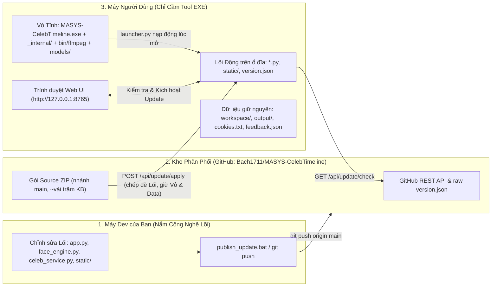
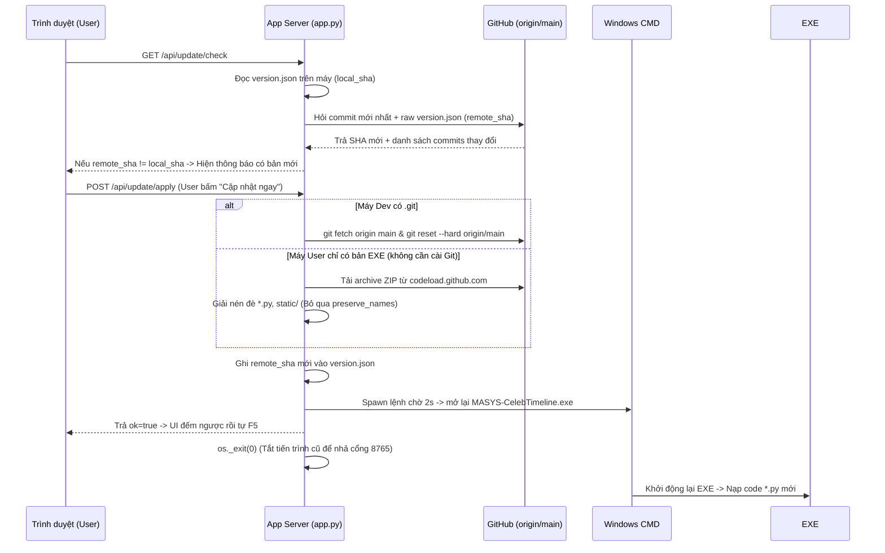

# MASYS CelebTimeline — Kiến trúc Auto-Update & Chiến lược Nắm Công Nghệ Lõi

Tài liệu giải thích cách hoạt động của cơ chế **1-Click Auto-Update** theo mô hình **Vỏ Tĩnh + Lõi Động (Static Shell & Hot-Swap Core)** và lộ trình nâng cấp để **bạn nắm công nghệ lõi, người dùng cuối chỉ cầm tool chạy**.

---

## 1. Sơ đồ Kiến trúc Tổng thể (System Architecture)

---

## 2. Luồng chạy chi tiết từng bước (Update Sequence Flow)

---

## 3. Phân tích kỹ thuật trong mã nguồn hiện tại

### 3.1. Tách Vỏ Cứng & Lõi Động (`build_exe.bat` + `launcher.py`)
- **Phần Vỏ Cứng (`MASYS-CelebTimeline.exe` + `_internal/` + `bin/` + `models/`):**
  - Được đóng gói 1 lần bằng PyInstaller (`--onedir`) chứa Python runtime, FastAPI, Uvicorn, OpenCV, yt-dlp, Pillow và FFmpeg (~675 MB).
  - Trong `build_exe.bat`, các module nghiệp vụ (`app`, `celeb_service`, `face_engine`, `youtube_pipeline`, `renderer`) bị loại khỏi bundle nhờ cờ `--exclude-module`.
- **Phần Lõi Động (`*.py`, `static/`, `version.json`):**
  - Nằm trực tiếp bên cạnh `MASYS-CelebTimeline.exe`.
  - Khi mở `.exe`, `launcher.py` kiểm tra cổng `8765`; nếu chưa chạy thì gọi `importlib.import_module("app")` để nạp code từ ổ đĩa rồi chạy server Uvicorn.
  - Lợi ích: Mỗi lần bạn sửa tính năng, người dùng **không phải tải lại ~675 MB** mà chỉ tải phần code nhẹ bên ngoài.

### 3.2. Kiểm tra phiên bản (`_get_local_version_info`, `_fetch_remote_github_info`, `/api/update/check`)
1. Đọc `version.json` tại máy khách để lấy `local_sha` và nhãn phiên bản (`ver X.Y`). Nếu máy có `.git`, ưu tiên đọc trực tiếp `git rev-parse HEAD`.
2. Gọi GitHub REST API (`api.github.com/repos/Bach1711/MASYS-CelebTimeline/commits/main`) và `raw.githubusercontent.com/.../version.json` để lấy `remote_sha` và `remote.version`.
3. Nếu `remote_sha != local_sha` (và không phải nhánh local đang đi trước remote), gọi tiếp `/compare/{local_sha}...{remote_sha}` để lấy tối đa 10 commit gần nhất làm changelog hiển thị trên modal.

### 3.3. Tải & Ghi đè an toàn (`/api/update/apply`)
- **Nhánh 1 — Máy Dev có Git:** Chạy `git fetch origin main` và `git reset --hard origin/main`.
- **Nhánh 2 — Máy Người Dùng cầm EXE (`github_zip`):**
  - Tải ZIP trực tiếp từ `codeload.github.com/Bach1711/MASYS-CelebTimeline/zip/refs/heads/main` vào `workspace/_update_tmp`.
  - Chép đè mã nguồn mới vào `BASE_DIR`, **bỏ qua toàn bộ danh mục `preserve_names`**:
    `workspace`, `output`, `.git`, `__pycache__`, `feedback.json`, `cookies.txt`, `bin`, `_internal`, `MASYS-CelebTimeline.exe`, `MASYS-CelebTimeline_EXE`.
  - Nhờ danh sách này, video khách đang làm dở, file xuất MP4, cookie và bộ `.exe` gốc được bảo toàn 100%.

### 3.4. Tự khởi động lại không cần người dùng thao tác (`_schedule_server_restart`)
- Sau khi ghi `version.json` mới, server mở một tiến trình CMD nền:
  `timeout /t 2 /nobreak >nul & start "" "<đường dẫn MASYS-CelebTimeline.exe>" --no-browser`
- Trả JSON `ok: true` về trình duyệt để UI đếm ngược rồi reload, đồng thời gọi `os._exit(0)` tắt ngay tiến trình cũ để giải phóng cổng `8765`.

---

## 4. Lộ trình "Bạn cầm công nghệ lõi — Người khác chỉ cầm tool"

Ở bản MVP hiện tại (`ver 0.1`), kho GitHub để ở chế độ **Public** và các file `.py` nằm dạng mã nguồn mở cạnh `.exe`. Khi đưa ra thị trường / bán hoặc phân phối rộng rãi, có **3 cấp độ bảo vệ** nâng cấp trực tiếp trên kiến trúc sẵn có:

| Cấp độ | Giải pháp kỹ thuật | Mức độ bảo vệ | Trải nghiệm người dùng |
| :--- | :--- | :--- | :--- |
| **Cấp 1: Khóa nguồn phân phối** | Chuyển repo GitHub sang **Private**. Dựng 1 API trung gian (VPS / Cloudflare Worker) kiểm tra **License Key + HWID máy** rồi mới cấp URL/luồng tải ZIP update. | Không ai ngoài bạn truy cập được repo hay tải chui bản update. | Nhập License Key 1 lần khi mở app, sau đó vẫn bấm 1-Click Update bình thường. |
| **Cấp 2: Biên dịch Lõi sang nhị phân (`.pyd`)** | Trước khi đóng gói update ZIP, dùng **Cython** hoặc **Nuitka** biên dịch `app.py`, `face_engine.py`, `celeb_service.py`, `youtube_pipeline.py` thành file DLL `.pyd`. `launcher.py` vẫn `importlib.import_module("app")` chạy bình thường. | Người dùng mở thư mục EXE chỉ thấy file `.pyd` nhị phân, **không đọc được thuật toán Python**. | Vẫn hot-swap update nhẹ (~vài MB), tốc độ xử lý thậm chí nhanh hơn. |
| **Cấp 3: Đưa "Não" lên Cloud (Thin Client)** | Giữ phần nặng tài nguyên (tải YouTube, FFmpeg cắt/ghép video) chạy trên máy khách để tiết kiệm chi phí server; còn phần trí tuệ lõi (tìm timeline, chấm điểm AI, prompt, API key) đặt trên Backend server của bạn. | Kể cả dịch ngược toàn bộ client vẫn không lấy được logic lõi; thu phí theo lượt/tháng dễ dàng. | Chỉ đăng nhập tài khoản / token để dùng, luôn chạy bản thuật toán mới nhất không cần update tay. |
