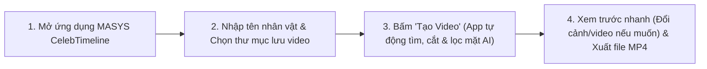

# TÀI LIỆU ĐẶC TẢ DỰ ÁN (PROJECT SPECIFICATION)
## Tên công cụ: **MASYS CelebTimeline**

---

## 1. Người dùng (Target Users)
* **Đối tượng chính:** Người xây dựng, vận hành và nuôi hệ thống kênh **TikTok** (cũng như YouTube Shorts / Reels) chuyên về chủ đề **Bản tin người nổi tiếng qua đời kết hợp nhìn lại hành trình cuộc đời & sự nghiệp qua các năm** (*Celebrity Death News & Career Evolution Timeline* — tương tự video mẫu `369.Catherine O'Hara 1954-2026.mp4`).
* **Đặc điểm nhu cầu:**
  * Cần sản xuất video đều đặn với tốc độ nhanh, thao tác tối giản nhất có thể.
  * Yêu cầu định dạng đầu ra đồng nhất theo chuẩn kênh (khung dọc 9:16, thời lượng khoảng ~1 phút, giữ tiếng đoạn bản tin đầu và tắt tiếng hoàn toàn ở các đoạn năm để khi đăng lên TikTok người dùng tự gắn nhạc trên TikTok).

---

## 2. Vấn đề (Problem Statement)
Quy trình làm video thủ công hiện tại tốn rất nhiều thời gian và công sức ở cả 3 khâu:
1. **Tìm kiếm nguồn video thủ công:** Phải lên YouTube gõ tìm từng video bản tin (`"Celebrity deaths news"`) và gõ tìm lẻ tẻ từng mốc năm của nhân vật (ví dụ: `"Catherine 1983"`, `"Catherine 1990"`... cho 8–10 mốc năm khác nhau).
2. **Xem và cắt lọc thủ công:**
   * Phải xem các video bản tin tổng hợp dài nhiều phút để nghe và tìm đúng câu dẫn thông báo về nhân vật chính (dài khoảng 8–15 giây) rồi cắt bỏ phần còn lại.
   * Phải mở từng video của từng năm, tua tìm và cắt ra đoạn 3–4 giây sao cho khung hình phải chứa rõ khuôn mặt của nhân vật chính (tránh cắt nhầm cảnh MC, người phỏng vấn hoặc cảnh không có mặt nhân vật).
3. **Dựng hậu kỳ lặp đi lặp lại:** Phải đưa hàng chục đoạn cắt vào phần mềm edit, căn chỉnh khung hình 9:16, tắt âm thanh gốc của tất cả các video năm, gõ từng nhãn số năm và chờ xuất file.

---

## 3. Luồng người dùng (User Flow)
Luồng thao tác được tối giản hóa tối đa để người dùng chỉ cần vài cú nhấp chuột là có video thành phẩm:

1. **Bước 1:** Người dùng mở ứng dụng **MASYS CelebTimeline** trên máy tính.
2. **Bước 2:** Người dùng nhập **Tên nhân vật** và chọn **Thư mục lưu video đầu ra (Output Folder)**.
3. **Bước 3:** Người dùng bấm nút **Tạo video**.
4. **Bước 4:** Ứng dụng tự động thực hiện toàn bộ quá trình tìm kiếm, cắt bản tin, lọc khuôn mặt theo từng năm, cho phép xem trước nhanh (nếu muốn đổi đoạn nào chưa ưng) và ghép thành file `.mp4` hoàn chỉnh lưu thẳng vào thư mục đã chọn.

---

## 4. Luồng ứng dụng (Application / System Flow)
Hệ thống tự động hóa hoàn toàn 3 bước nghiệp vụ cốt lõi:

### **Giai đoạn 1: Tra cứu thông tin & Khởi tạo dữ liệu nhân vật**
1. Dựa vào tên nhân vật người dùng nhập, ứng dụng tự động truy vấn Wikipedia để lấy:
   * Năm sinh và năm mất (hoặc năm hiện tại).
   * Tự động tính toán và đề xuất **8–10 mốc năm tiêu biểu** trải đều sự nghiệp của nhân vật (sao cho tổng thời lượng khi ghép với bản tin đạt khoảng ~1 phút).
   * Tải ảnh chân dung chuẩn của nhân vật và trích xuất **Vector đặc trưng khuôn mặt (Face Embedding)** bằng mô hình AI `OpenCV SFace` làm mẫu đối chiếu.

### **Giai đoạn 2: Tự động Tìm kiếm, Dò phụ đề & Cắt lọc Video (YouTube + AI)**
1. **Xử lý đoạn Bản tin mở đầu (8–15 giây):**
   * Tìm kiếm video bản tin trên YouTube theo từ khóa liên quan đến bản tin qua đời của người nổi tiếng (`"<Tên nhân vật> dead breaking news"`, `"Celebrity deaths news <Tên nhân vật>"` hoặc từ link bản tin tổng hợp).
   * Quét dữ liệu **Phụ đề có mốc thời gian (`YouTube Timed Transcript`)** để tự động xác định chính xác giây bắt đầu và giây kết thúc của câu dẫn thông báo về nhân vật chính (dài 8–15 giây).
   * Sử dụng `yt-dlp` tải trực tiếp phân đoạn đó (không cần tải cả video dài nhiều phút) và **giữ nguyên âm thanh gốc** của người dẫn chương trình.
2. **Xử lý chuỗi 8–10 Video theo từng Năm (3–4 giây / video):**
   * Với mỗi mốc năm (ví dụ: `1982`, `1990`, `2015`, `2026`...), tự động tìm video trên YouTube với từ khóa `"<Tên nhân vật> <Năm>"`.
   * Tải phân đoạn video và đưa qua bộ lọc **AI Nhận diện & So khớp Khuôn mặt (`OpenCV YuNet + SFace`)**:
     * Phát hiện các khuôn mặt xuất hiện trong từng khung hình.
     * So khớp độ tương đồng với ảnh chân dung mẫu của nhân vật chính (tránh cắt nhầm mặt người phỏng vấn hoặc diễn viên phụ).
     * Chấm điểm độ rõ nét, kích thước khuôn mặt và tính liên tục để tự động cắt ra đúng **3–4 giây** đẹp nhất.
3. **Xem trước & Đổi nhanh (Preview):**
   * Hiển thị trực quan đoạn bản tin và 8–10 đoạn video năm đã cắt trên giao diện.
   * Hỗ trợ nút bấm 1 chạm để **Đổi cảnh khác (cùng video)** hoặc **Đổi sang video YouTube khác** nếu người dùng muốn thay thế một mốc năm bất kỳ.

### **Giai đoạn 3: Dựng Hậu kỳ & Xuất Video Thành phẩm (`FFmpeg`)**
1. **Chuẩn hóa khung hình:** Đưa toàn bộ các đoạn video về chuẩn khung dọc TikTok **`1080×1920` (9:16), 30fps**, vùng hiển thị video nằm chính giữa với nền đen phía trên và phía dưới (đồng bộ 100% với video mẫu `369.Catherine O'Hara 1954-2026.mp4`).
2. **Xử lý hình ảnh & nhãn chữ (Text Overlay):**
   * Đoạn bản tin mở đầu: Không chèn chữ số năm.
   * Các đoạn video theo năm: Tự động vẽ nhãn **Số năm (ví dụ: `1983`, `1990`, `2026`) màu vàng tươi (`#FFE600`), viền đen đậm**, căn giữa ở cạnh dưới của khung hình video.
3. **Xử lý âm thanh:**
   * **Đoạn bản tin (8–15s đầu):** Giữ nguyên âm thanh gốc của MC truyền hình.
   * **Các đoạn video năm (từ sau bản tin đến hết video):** Xóa bỏ hoàn toàn âm thanh gốc (để im lặng — giúp người dùng chủ động chèn nhạc trực tiếp trên TikTok khi đăng bài).
4. **Xuất file:** Lưu trực tiếp file `.mp4` hoàn chỉnh vào **Thư mục lưu video** mà người dùng đã chọn trên giao diện.

---

## 5. Những thứ không làm (Out of Scope / Non-Goals)
Để giữ cho công cụ tinh gọn, nhanh và ổn định đúng mục đích, dự án sẽ **KHÔNG** làm những việc sau:
1. **Không ghép nhạc nền vào video:** Ứng dụng chỉ giữ tiếng gốc ở đoạn Bản tin mở đầu và tắt hoàn toàn tiếng ở các đoạn video năm; việc chọn và ghép nhạc nền sẽ do người dùng thực hiện trực tiếp trên ứng dụng TikTok lúc đăng bài.
2. **Không làm phần mềm dựng phim đa năng phức tạp:** Không xây dựng timeline đa lớp (multi-track timeline), keyframe thủ công hay kho hiệu ứng chuyển cảnh rườm rà như CapCut/Premiere.
3. **Không tự động đăng bài lên mạng xã hội:** Không tích hợp API tự động upload lên TikTok/YouTube hay quản lý tài khoản kênh (đầu ra cuối cùng của tool là file `.mp4` hoàn chỉnh nằm trong thư mục máy tính của người dùng).
4. **Không dùng AI tạo sinh hình ảnh/giọng nói giả (No Deepfake / No TTS):** Không tạo giọng đọc AI hay tạo video giả lập; chỉ sử dụng tư liệu bản tin và video thật từ YouTube.
5. **Không phụ thuộc dịch vụ đám mây hay API trả phí:** Không yêu cầu đăng nhập tài khoản, không lưu trữ video lên server bên ngoài, không dùng các API tốn phí theo lượt chạy — toàn bộ xử lý chạy 100% cục bộ (Local) trên máy tính của người dùng.
6. **Không tải toàn bộ video gốc dung lượng lớn:** Không tải cả một video dài 20–30 phút về máy gây tốn dung lượng ổ cứng và thời gian chờ, mà chỉ tải đúng phân đoạn ngắn cần thiết.

---

## 6. Định nghĩa hoàn thành (Definition of Done - DoD)
Dự án được coi là **Hoàn thành** khi đáp ứng đầy đủ các tiêu chí nghiệm thu sau:
1. **Giao diện đơn giản, dễ dùng:** Người dùng mở ứng dụng lên, chỉ cần thực hiện vài bước cơ bản (**Nhập tên nhân vật $\rightarrow$ Chọn thư mục lưu video $\rightarrow$ Bấm Tạo/Xuất video**) là có thể vận hành trọn vẹn.
2. **Tự động hóa trọn vẹn quy trình 3 bước:**
   * Tự tìm và cắt được đoạn bản tin mở đầu (8–15s, giữ nguyên tiếng MC thông báo về nhân vật).
   * Tự tìm và cắt được 8–10 đoạn video theo các mốc năm (3–4s/đoạn, có mặt nhân vật chính nhờ bộ lọc khuôn mặt AI, đã tắt tiếng gốc).
   * Cho phép xem trước nhanh và đổi đoạn cắt chỉ bằng 1 cú nhấp chuột nếu cần.
3. **Đầu ra (Output) đạt chuẩn chất lượng kênh TikTok:**
   * File `.mp4` xuất ra có tổng thời lượng khoảng **~1 phút** (`40–65 giây`), độ phân giải `1080×1920` (9:16, 30fps).
   * Đoạn bản tin đầu có tiếng gốc, các đoạn năm phía sau tắt tiếng hoàn toàn và hiển thị rõ nét nhãn **Số năm màu vàng viền đen**.
   * File thành phẩm được lưu tự động vào đúng **Thư mục lưu video** mà người dùng đã chỉ định.

---

## 7. Thiết kế Giao diện (UI Mockup) & Hiện trạng Code trong thư mục
* **Mẫu giao diện chuẩn đã chọn:** Xem file `mockups.html` trong cùng thư mục dự án (**Phương án 3: Giao diện Bảng Lưới Storyboard - Tông Sáng / Light Mode**).
  * **Thanh điều khiển trên cùng (Nền sáng):** Nhập `1. Tên người nổi tiếng`, chọn `2. Thư mục lưu video đầu ra` (có nút `📂 Chọn...` mở hộp thoại chọn thư mục Windows), nút `🚀 1. Tạo Video (Tìm & Cắt)` và nút `💾 2. Xuất MP4`.
  * **Bảng lưới Storyboard bên dưới (4 cột):**
    * Ô đầu tiên: Video `📺 BẢN TIN MỞ ĐẦU` (có trình phát `<video>` giữ tiếng gốc MC, nút `🔄 Đổi bản tin` và `✂️ Chỉnh giây`).
    * Các ô tiếp theo: Video của từng mốc năm (`1983`, `1990`, `2026`...) tự động phát lặp lại (`autoplay loop muted`) ngay trên từng ô, hiển thị nhãn số năm màu vàng viền đen, tỷ lệ khớp mặt AI (`👤 AI: %`) và 2 nút `✨ Đổi cảnh` (đổi góc mặt khác trong cùng video) / `🔄 Đổi video` (đổi sang video YouTube khác).
* **Các module đã có sẵn trong thư mục cần kế thừa & đồng bộ theo Spec:**
  * `face_engine.py`: Đã hoàn chỉnh (nhận diện & so khớp khuôn mặt bằng `OpenCV YuNet + SFace` với model trong `models/`).
  * `celeb_service.py`: Đã hoàn chỉnh (tra cứu Wikipedia lấy năm sinh/mất, các mốc năm, ảnh chân dung mẫu).
  * `youtube_pipeline.py`: Đã hoàn chỉnh (tìm kiếm YouTube, đọc phụ đề cắt bản tin 8–15s và lọc khuôn mặt cắt video năm 3–4s).
  * `renderer.py`: Cần lược bỏ phần trộn nhạc nền (BGM) để chỉ giữ âm gốc ở đoạn bản tin đầu và tắt tiếng hoàn toàn ở các đoạn năm.
  * `app.py` & `static/index.html`: Cần cập nhật lại giao diện sang đúng chuẩn `mockups.html` (Tông sáng, Bảng lưới Storyboard, bỏ phần chọn nhạc nền, thêm nút mở hộp thoại chọn thư mục lưu video đầu ra).
